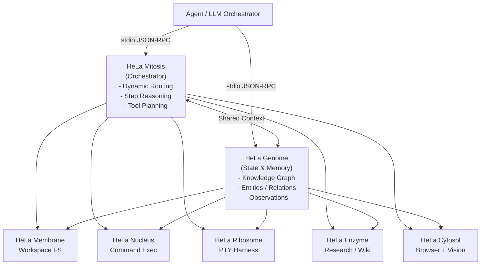

# HeLa MCP Ecosystem

A modular, immortal cellular AI tooling ecosystem built on the Model Context Protocol (MCP), engineered by Azzar to equip AI agents with full-spectrum autonomous capabilities across reasoning, persistent memory, workspace management, system execution, research, design, device automation, and 3D modeling.

> **New to MCP?** Read the **[Beginner's Guide](docs/beginner-guide.md)** for requirements, profile selection, installation, and verification.

**Read all documentation on the website:** [Document library](https://hela.my.id/library.html) · [Navigasi Bahasa Indonesia](https://hela.my.id/id/library.html). Guides, release history, contribution rules, and verification reports are published in full, with search and source downloads. Documents retain their source language.

Current source snapshot: **v1.9.3**, with runtime **1.3.0**. True first-call startup, fingerprinted discovery caches, canonical inventory tooling, profile-aware local capabilities, and managed snapshot updates are implemented; see [on-demand runtime](docs/on-demand-runtime.md) and [installation updates](docs/installation.md#updates-and-automatic-checks). Authenticated Zed/Codex ACP sessions, hardware integrations, and live vault conflict resolution remain separate; see [release notes](RELEASE_NOTES.md).


---

## Respectful Attribution & Metaphor

The **HeLa MCP Ecosystem** is named in respectful recognition of **Henrietta Lacks** (1920–1951) and the immortal scientific legacy of HeLa cells, which transformed global biomedical research. In this software architecture, HeLa serves as a **cellular biology metaphor**:

* **Cellular Modularity**: Just as biological cells contain specialized organelles coordinated by the nucleus and genome, the HeLa MCP Ecosystem deploys specialized tool servers coordinated by a dual backbone.
* **Continuous Replicability & Immortality**: Environments can be snapshot-pinned, reproduced deterministically on any machine, and restored cleanly without state degradation.
* **Component Independence**: Underlying repositories, technical package names, and Git commit histories remain autonomous and unaltered while functioning as a harmonious organism.

---

## Dual-Backbone Architecture

Every profile in the HeLa ecosystem is anchored by two core backbone servers:



* **HeLa Mitosis (`hela-mitosis`)**: Cellular division and orchestration backbone. Handles dynamic tool routing, prompt decomposition, Needle-backed sequential reasoning (`sequentialthinking` / `agent_run`), and multi-tool planning.
* **HeLa Genome (`hela-genome`)**: Cellular memory and state backbone. Maintains the persistent SQLite knowledge graph (`memory.db`), entity-relation tracking, session restoration, and project milestones.

---

## 10-MCP Component Taxonomy

| Canonical Identity | Machine ID (`id`) | Technical Source Repo | Scope | Cellular Metaphor & Role |
|---|---|---|---|---|
| **HeLa Mitosis** | `hela-mitosis` | [`chaining-mcp`](https://github.com/Hela-Ecosystem/chaining-mcp) | Core | **Orchestrator**: Bundled Needle 3 agent runtime, dynamic routing, 40 bundled prompt templates |
| **HeLa Genome** | `hela-genome` | [`project-mcp`](https://github.com/Hela-Ecosystem/project-mcp) | Core | **State Backbone**: Entity-relation knowledge graph, milestone tracking, memory persistence |
| **HeLa Membrane** | `hela-membrane` | [`filesystem-mcp`](https://github.com/Hela-Ecosystem/filesystem-mcp) | Core | **Workspace**: Sandboxed filesystem operations, recursive search, archive extraction |
| **HeLa Nucleus** | `hela-nucleus` | [`terminal-mcp`](https://github.com/Hela-Ecosystem/terminal-mcp) | Core | **Execution**: Command execution, subshell isolation, RTK token-optimized execution |
| **HeLa Ribosome** | `hela-ribosome` | [`menager-mcp`](https://github.com/Hela-Ecosystem/menager-mcp) | Core | **Process Harness**: Interactive PTY multiplexing, Regex hooks, lifecycle management |
| **HeLa Enzyme** | `hela-enzyme` | [`researcher-mcp`](https://github.com/Hela-Ecosystem/researcher-mcp) | Core | **Knowledge**: Zero-key dual-tier web search + arXiv + Google News RSS + Wikipedia synthesis and fact-checking |
| **HeLa Cytosol** | `hela-cytosol` | [`browser-mcp`](https://github.com/Hela-Ecosystem/browser-mcp) | Core | **Interaction & vision**: Playwright automation, accessibility/DOM perception, OCR, visual analysis, detection, segmentation, and standalone image analysis |
| **HeLa Phenotype** | `hela-phenotype` | [`designer-mcp`](https://github.com/Hela-Ecosystem/designer-mcp) | Specialized | **Design**: UI/UX design tokens, OKLCH color palettes, Tailwind and component synthesis |
| **HeLa Receptor** | `hela-receptor` | [`scrcpy-mcp`](https://github.com/Hela-Ecosystem/scrcpy-mcp) | Specialized | **Mobile**: Android device automation, ADB bridge, XML view hierarchy inspection |
| **HeLa Plastid** | `hela-plastid` | [`ll3m-mcp`](https://github.com/Hela-Ecosystem/ll3m-mcp) | Specialized | **3D Modeling**: Autonomous Blender procedural modeling, materials, and render pipeline |

---

## Quick Start

### 1. Prerequisites
* **Node.js**: use Node 22 LTS for the tested full stack. Individual packages declare their own engine ranges; Receptor requires 22 and Enzyme requires at least 20.18.1.
* **Git**: `>= 2.30.0`
* **SQLite**: Genome uses Node bindings; the SQLite CLI is optional for inspection.

### 🤖 Install via AI Agent (One-Click Copy)

If you are using an AI coding assistant (Cursor, Claude Code, OpenCode, Codex, Antigravity, Windsurf), you can copy and paste this autonomous prompt directly into your agent's chat:

```text
Please autonomously install and configure the HeLa Cellular MCP Ecosystem through one profile-aware hela-runtime MCP endpoint:

1. Environment & Harness Detection:
   Verify Node.js (>= 22.x LTS), Git (>= 2.30.0), and build tools. Identify current client (Cursor, Claude, OpenCode, Antigravity, Zed, Codex).

2. Confirm the profile with the user before installing:
   Show https://hela.my.id/profiles.html for the quick comparison, and https://hela.my.id/library/docs/profiles.html for detailed persona, workflow, server membership, and prerequisite explanations. Ask which profile best fits the user's work: minimal, dev-workspace, headless-server, research, web-devops, android-testing, 3d-modeling, or all.
   Wait for the user's choice and call it <confirmed_profile>. If they do not choose, use minimal. Do not run setup until the profile is confirmed.

3. Clone & Install the Managed Runtime:
   git clone https://github.com/Hela-Ecosystem/hela-mcp-ecosystem.git
   cd hela-mcp-ecosystem
   # Windows PowerShell: .\setup.ps1 ... and .\setup.ps1 doctor ...
   # macOS/Linux: node setup.mjs ... (setup.sh remains a compatibility shim)
   node setup.mjs --profile <confirmed_profile> --client <detected_client> --mode runtime --non-interactive
   node setup.mjs doctor --profile <confirmed_profile> --mode runtime
   Safely merge generated client configuration into my active MCP configuration file.
   Do not deploy or configure each hela-* cell as a separate client server.

4. Synchronize Companion Skills:
   Run `npm run skills:sync -- --profile <confirmed_profile>` from the ecosystem checkout. This reads the manifest from `config/inventory.json` and mirrors the selected organelles' bundled skills into the harness skill directory.

5. Load the Runtime Profile Context:
   - If the selected workspace has no `agent_persona/` and no existing `AGENTS.md`, `CLAUDE.md`, or `GEMINI.md`, the installer creates the profile-aware HeLa persona there and links the harness entrypoints to it.
   - If a persona already exists, preserve it; do not overwrite the user's instructions. The runtime profile context remains authoritative for active organelles and tools.
   - After connecting, read the `hela://profile/context` resource or request the `hela-profile-bootstrap` MCP prompt.
   - Treat the selected runtime profile as the authority for active organelles and available tools.

6. Final Handshake:
   Initialize the workspace memory graph through the exposed Genome tool when that organelle is active, and confirm the selected profile and runtime tools.
```

### 2. Run Diagnostics (`node setup.mjs doctor`)
Clone the source, then select an installation mode:

```bash
git clone https://github.com/Hela-Ecosystem/hela-mcp-ecosystem.git
cd hela-mcp-ecosystem
node setup.mjs --mode runtime --profile dev-workspace --client opencode --non-interactive
node setup.mjs doctor --mode runtime --profile dev-workspace
```

### 3. Interactive Installation & Profile Selection
```bash
node setup.mjs
```

### 4. Non-Interactive One-Liners

**Full Developer Desktop (Cursor IDE):**
```bash
node setup.mjs --profile dev-workspace --client cursor --non-interactive
```

**Headless Linux Server (Claude Desktop / CLI):**
```bash
node setup.mjs --profile headless-server --client claude --non-interactive
```

**Pinned Immutable Release Snapshot:**
```bash
node setup.mjs --profile dev-workspace --client cursor --snapshot v1.9.3 --non-interactive
```

**Single-endpoint Runtime (one MCP connection for the selected profile):**
```bash
node setup.mjs --profile dev-workspace --client opencode --runtime --non-interactive
```

**Change an existing installation's mode in place:**
```bash
node setup.mjs mode --prefix /path/to/prefix --mode docker-runtime --client opencode --non-interactive
```

**Docker cells, Docker runtime, or Nix runtime:**
```bash
node setup.mjs --mode docker --profile dev-workspace --client cursor --non-interactive
node setup.mjs --mode docker-runtime --profile dev-workspace --client opencode --non-interactive
node setup.mjs --mode nix --profile dev-workspace --client codex --non-interactive
```

Installs use private managed prefixes under `${XDG_DATA_HOME:-$HOME/.local/share}/hela/installations/`. Existing repositories and live client files are not overwritten. Review and merge the generated client fragment. Use `--prefix` for an explicit location and pass it to doctor. See [installation modes and doctor](docs/installation.md) for HTTP transport, Compose, Nix GC roots, snapshots, optional model assets, prerequisites, and failure recovery.

---

## Supported AI Clients & Output Formats

The installer writes private fragments inside its prefix, never directly into live client files:

- Cursor, Claude, Gemini, Antigravity: `mcpServers` JSON.
- OpenCode and Kilo: `mcp` JSON with an installed local launcher, or a runtime HTTP URL.
- Zed: `context_servers` JSON; preserve unrelated settings when merging.
- Codex: `[mcp_servers.*]` TOML, with a launcher or HTTP URL.
- Docker: functional `compose.json` for the built image, not speculative per-cell Dockerfiles or stdio port mappings.

`--client skip` installs without generating a client fragment. Client authentication and GUI acceptance remain separate.

---

## Available Agent Profiles

| Profile ID | Target System | Backbone Included | Servers Included | Focus Area |
|---|---|---|---|---|
| `minimal` | Any | Mitosis + Genome | Enzyme | Research and memory without GUI dependencies |
| `dev-workspace` | Any (GUI recommended) | Mitosis + Genome | Membrane, Nucleus, Ribosome, Enzyme, Phenotype, Cytosol | Full-stack software engineering, testing, web UI |
| `headless-server` | Headless Linux | Mitosis + Genome | Membrane, Nucleus, Ribosome, Enzyme, Phenotype | Cloud server administration, CI/CD, headless dev |
| `research` | Headless or GUI | Mitosis + Genome | Enzyme, Membrane, Cytosol | Deep literature research, document synthesis, web crawling |
| `web-devops` | Headless or GUI | Mitosis + Genome | Membrane, Nucleus, Phenotype, Cytosol | Frontend development, Tailwind styling, DOM verification |
| `android-testing` | Device connected | Mitosis + Genome | Nucleus, Receptor, Enzyme | Mobile QA testing, ADB automation, APK validation |
| `3d-modeling` | GUI (Blender installed) | Mitosis + Genome | Plastid, Membrane, Nucleus | 3D procedural modeling, materials, rendering |
| `all` | Full workstation | Mitosis + Genome | All 10 HeLa MCP servers | Complete full-spectrum AI agent capabilities |

> **Single-endpoint serve mode:** add `--runtime` to a profile command. If no profile is selected, the runtime and installer default to `minimal`; choose `dev-workspace` or another profile explicitly.

Profiles are installation choices, not machine-specific code paths. All eight pass isolated runtime verification with namespacing off/on (**16 checks**), including exact tool/schema parity and safe read-only routing. Lappy's ten-server `all` roster and servy's eight-cell `dev-workspace` setup remain different by design. See [all-profile verification](docs/profile-verification-2026-11-06.md); run `npm run test:profiles`, or append `-- --profile <id>` on a partial installation.

Runtime discovery now starts **zero cells**; only invoked cells are started. [Generated profile counts](docs/generated-profile-counts.md) come from the inventory/catalog rather than static client-specific totals. `node setup.mjs doctor --profile <id> --runtime` checks cold catalog parity as well as versions, paths, and revisions.

For complete persona guides and pipeline specifications, see **[Profiles Catalog](docs/profiles.md)**.

---

## Operational Workflows (Workflows A–F)

The ecosystem is built for structured multi-server agent workflows:
* **Workflow A: Autonomous Feature Engineering**: Genome (restore) → Mitosis (decompose) → Membrane (code) → Nucleus (test) → Genome (persist).
* **Workflow B: Deep Research & Architecture Synthesis**: Enzyme (search) → Cytosol (scrape) → Mitosis (synthesize) → Genome (record) → Membrane (write).
* **Workflow C: Web Feature with Design & Browser Verification**: Phenotype (tokens) → Membrane (build) → Nucleus (serve) → Cytosol (DOM QA) → Genome (record).
* **Workflow D: Mobile App Test Automation**: Genome (issue) → Nucleus (adb) → Receptor (drive UI) → Genome (record pass).
* **Workflow E: Autonomous 3D Asset Creation & Render Pipeline**: Genome (spec) → Mitosis (plan) → Plastid (Blender) → Membrane (save) → Genome (record).
* **Workflow F: Long-Horizon Complex Refactor with PTY Harness**: Ribosome (PTY) → Nucleus (exec) → Genome (persist).

For step-by-step tool invocation sequences, schemas, and diagrams, see **[Workflows & Integration Guide](docs/workflows.md)**.

---

## Project Health & Diagnostics

```bash
# Run system and server diagnostic health check
npm run doctor
# or
node setup.mjs doctor

# Run 80-combination client configuration checks (not GUI integration)
npm run test:matrix
npm run build:all -- --profile <confirmed_profile>
npm run test:all -- --profile <confirmed_profile>

# Run master integration test suite across all 10 servers (tool counts are feature-dependent)
npm test

# Sync bundled agent skills into the harness skills directory
npm run skills:sync

# Report skill drift without changing the target
npm run skills:check
```

---

## Documentation Index

* **[Beginner's Step-by-Step Guide](docs/beginner-guide.md)**: 3-minute, zero-code onboarding.
* **[Keys & Secrets Guide](docs/keys-and-secrets.md)**: API key setup, sign-up URLs, and zero-key offline fallbacks.
* **[Profiles Reference](docs/profiles.md)**: Full persona reference and capability mappings.
* **[Workflows & Integration Guide](docs/workflows.md)**: Cross-MCP workflow pipelines (Workflows A–F).
* **[Security & Reliability Audit](docs/security-audit.md)**: Threat model, sandboxing, and isolation standards.
* **[Architecture Guide](docs/architecture.md)**: In-depth cellular architecture and communication topologies.
* **[Troubleshooting Guide](docs/troubleshooting.md)**: Common issues, diagnostic codes, and recovery procedures.

---

## License & Attribution

Distributed under the MIT License. Underlying repositories remain independently copyrighted by their respective authors.

The HeLa project respectfully recognizes **Henrietta Lacks** and the enduring scientific legacy of HeLa cells.
