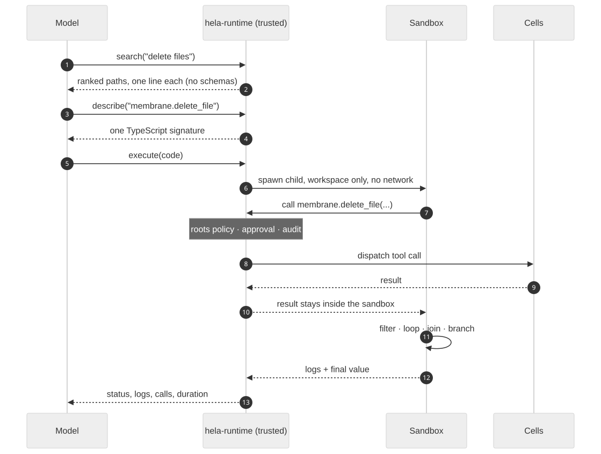

# Code Mode for HeLa: research and design

Status: research. Nothing here is implemented.

The question: should the ecosystem expose **one code-execution tool** instead of (or beside)
hundreds of MCP tool schemas — and what would that cost in security and complexity?

Two independent labs published the same pattern within six weeks of each other, from very
different platforms. That coincidence is the strongest signal in this document. The evidence
is thinner than the blog posts suggest, and the sandbox is the whole problem.

## 1. What Code Mode is

The model receives one tool whose input is source code. That code calls typed functions
representing the connected tools, runs in a sandbox, and returns only its final output.
Intermediate results never enter the model's context.

```
direct tool calling                    code mode
─────────────────                      ─────────
model → tool call → result             model → code ──┐
model → tool call → result                          ├─ sandbox: call, filter, loop
model → tool call → result                          ├─ sandbox: call, join
model → answer                                      └─ return only the answer
```

Three claims are made, and they fail or succeed independently:

1. **Context economy** — schemas and intermediate results stop competing with the task.
2. **Composition** — loops, branches, joins and retries move out of the message loop.
3. **Accuracy** — models write better code than tool-call JSON, because they have seen more
   of it.

Claim 3 is repeated most and evidenced least.

## 2. Evidence, and what each source actually shows

| Source | Claim | What it demonstrates | Confidence |
|---|---|---|---|
| Anthropic, *Code execution with MCP* (Nov 2025) | 150k → 2k tokens, "98.7%" | One worked example with a generated tool-file tree; illustrative, not a benchmark | Direction yes, magnitude no |
| Cloudflare, *Code Mode* (Sep 2025) | "Striking" results; more and more complex tools as TypeScript | Qualitative engineering report; no published eval or failure rates | Medium |
| CodeAct (ICML 2024) | Code actions beat JSON/text "up to 20%" | 17 LLMs, API-Bank plus a new benchmark | High for code-as-action; not MCP-specific |

None of them quantify: how often generated code is wrong where a tool call would have
succeeded, what the sandbox costs to operate, or who reviews code that mutates state.

## 3. What it would cost *here*, measured

Measured against this installation's live catalog, not a hypothetical:

| Metric | Value |
|---|---|
| Reachable tools in one session | 305 |
| `tools/list` schema size | **161 KB** |
| Estimated tokens (bytes ÷ 4) | **≈ 40,000** |
| Average schema per tool | 528 B |
| Largest single schema | 4.9 KB (`logo_workflow`) |
| Declared across all cells | 591 (286 shadowed by bare-name collisions) |

40k tokens is roughly a fifth of a 200k window, paid before the first request. Namespacing
every tool would make the number worse, not better — 591 schemas. That is the real
motivation: not that code mode is fashionable, but that this catalog is too large to inline.

Two honest caveats:

- Providers cache tool definitions (Anthropic prompt caching, OpenAI automatic caching), so
  the *marginal* cost is lower than 40k per turn. The context window is still occupied, and
  cache reads are cheap but not free.
- The saving only converts to wall-clock or accuracy if the model actually needed most of
  those schemas. For a single-tool task, inlining 305 tools versus loading one costs the same
  either way — and code mode adds a sandbox and a failure mode for nothing.

## 4. Critiques worth taking seriously

- **You still need the types.** Code that calls `membrane.read_file(path, encoding)` must
  know the signature. Without `describe`, models hallucinate parameters; with it, you have
  traded a schema block for a discovery round-trip. Neither is free.
- **Debugging moves to the model.** A failed tool call returns a tool error. Failed code
  returns a stack trace through a sandbox; the retry burns tokens on the whole program, not
  one call.
- **Reviewability drops by default.** Tool calls are individually visible in a transcript;
  one execution that makes forty calls is not, unless the runtime logs each proxied call.
  Auditability must be designed in, not inherited.
- **Prompt injection becomes code execution.** If any tool output can steer the model, the
  blast radius is now "whatever the sandbox allows" instead of "whatever the next tool call
  allows". This is the argument for keeping credentials and network out of the sandbox.
- **It rewards strong models.** CodeAct shows gains across 17 models, but the spread is wide;
  a weaker model writing a 40-line program that half-works is worse than three tool calls.
- **Sandbox dependencies rot.** Native modules (`isolated-vm`) must be rebuilt per Node ABI;
  WASM runtimes are stable but slow. The cheapest robust option is an OS-level boundary
  around a plain Node child process.

## 5. Three designs

**A. Execute + discover inside the runtime (recommended).** Two new tools beside the existing
ones: `hela.execute({code})` and a discovery path (`search`, `describe`). Every sandbox call
proxies back to the runtime, which applies the same roots policy, approvals and audit as a
direct call.



*Source: [09-code-mode-flow.mmd](../assets/diagrams/09-code-mode-flow.mmd).*

**B. Filesystem of tools.** Generate `servers/<cell>/<tool>.ts` plus `index.ts` and let the
agent read what it needs. Anthropic's shape. Cheapest to bolt on, but it needs a readable
filesystem inside the sandbox and costs more tokens per discovery than one `describe` call.

**C. Keep direct calls.** Correct for small catalogs; at 305 tools it is what we do now.

A and B compose: A's `describe` can serve the same generated text B writes to disk.

## 6. Trust boundary



*Source: [10-code-mode-boundary.mmd](../assets/diagrams/10-code-mode-boundary.mmd).*

The rule that makes the design coherent: **capabilities live in the parent; the sandbox holds
none.** No network, no host filesystem beyond a per-execution workspace, no environment, no
credentials. Tool calls cross one RPC channel that the parent validates. If the sandbox is
compromised, an attacker gets a workspace and a list of tool calls that policy already allows.

## 7. Sandbox options on Linux

| Option | Isolation | Cost | Verdict |
|---|---|---|---|
| `node:vm` in-process | **none** — documented as not a security boundary | ~0 | Only for trusted snippets; never for model output |
| Node permission model | fs/net/child-process gating | ~25 ms | Useful hardening; not a security boundary |
| Bun | none by default | low | Reject |
| Deno subprocess | capability-based, deny by default | 30–50 ms | Strong ergonomics; ships a second runtime |
| QuickJS (WASM) | strong; no host bindings unless exposed | low, slow compute | Good for pure logic, awkward for async RPC |
| `isolated-vm` | V8 isolate, memory-isolated | native build per ABI | Strong; maintenance risk |
| Child process + Landlock/seccomp | kernel-enforced fs/net | ~20 ms | Best complement; Linux-only |

Recommendation: **child process + Landlock (or `bwrap`) profile + stdio RPC**, with the
parent enforcing time, memory, call budget and output size. It is not containment against a
kernel exploit; it is containment against `rm -rf ~`, `curl | sh`, and runaway loops — which
is the realistic threat for a local, single-user agent.

Note what this machine already grants: the nucleus cell runs arbitrary shell commands today.
Code mode does not add a capability class here; it adds a *narrower, audited* interface and a
place to enforce limits that raw shell access does not have. A sandbox weaker than the
existing shell would be theatre.

## 8. Progressive discovery

Loading 305 signatures up front recreates the problem. Two tools instead:

- `search(query, {limit})` → ranked `{path, cell, tool, one_line}`, no schemas.
- `describe(path)` → one TypeScript signature plus its doc comment.

Detail levels (name / signature / full) matter: triage does not need parameter docs.
Names must be unique for paths to exist, which is the concrete argument for turning
namespacing on: 286 declared tools have no addressable identity today because a later cell
shadows the bare name.

## 9. Execution contract

```
hela.execute({ code, timeout_ms?, max_calls? })
  → { status: "ok" | "error" | "timeout" | "denied",
      result, logs,
      calls: [{ path, ms, ok }],
      duration_ms }
```

Enforced by the parent, not the sandbox: wall clock (default 30 s), output (256 KB, then
truncate with a marker), call count (default 50), memory (rlimit/cgroup).

Failures are data. Sandbox error, tool error and policy denial all return a structured
`status` so the model can retry or report, and the host never dies from generated code.

## 10. Security model

| Threat | Mitigation | Residual |
|---|---|---|
| Injected code exfiltrates files | no network, workspace-only fs, roots policy per call | data can be written into an allowed root and read later |
| Destructive calls (`delete_file`, archive extract) | per-tool approval; mutating tools denied by default in code mode | approved code can still be wrong |
| Resource exhaustion | time, call budget, memory, output caps | legal-but-heavy work still costs CPU |
| Secrets reachable from code | credentials stay in the parent; bindings, not env | a tool returning secrets leaks them into `logs` |
| No audit trail | every RPC logged: path, args digest, duration, execution id | logs hold digests, not payloads |

Approval fatigue is the realistic failure: a prompt people click through is not a control.
Read-only tools should run unprompted; only mutations should stop.

## 11. Implementation plan

Phase 1 — read-only, no approvals:
1. `code-mode/catalog.mjs`: unique path per tool from live `tools/list`; one-line summary and
   full signature per tool.
2. `code-mode/search.mjs`: token-overlap or BM25 over name + description. No embeddings.
3. `code-mode/executor.mjs`: child process, stdio RPC, Landlock/bwrap profile, kill on
   timeout.
4. Register `hela.execute` and `hela.describe` behind `HELA_CODE_MODE=1`.
5. Tests: escape attempts (fs outside workspace, `fetch`, `process`, infinite loop, memory
   bomb) and golden multi-step tasks.

Phase 2: approval policy for mutating tools; append-only audit log; `--dry-run` returning
planned calls without executing them.

Phase 3: snippets — save a successful execution as a skill under
`~/.local/share/hela/snippets` with a `SKILL.md`, discoverable by `search`. This is the part
that compounds: capability grows without schemas growing.

Measure before/after on three fixed tasks: schema bytes in context, model-mediated calls,
wall time, wrong-tool rate. If the schema saving does not show up as wall-time or error-rate
improvement, stop at phase 1.

## 12. What would make this not worth doing

- If client-side caching keeps schemas out of context, claim 1 mostly evaporates and only
  composition remains.
- If HeLa's task mix is mostly single-tool, code mode adds a sandbox for nothing. Measure the
  mix first.
- If the sandbox ends up in-process, the honest description is "no sandbox", and approvals
  stop being optional.

## Sources

- Cloudflare, *Code Mode: the better way to use MCP* — https://blog.cloudflare.com/code-mode/
- Cloudflare, *Code Mode* and *How Code Mode works* — https://developers.cloudflare.com/agents/tools/codemode/
- Anthropic, *Code execution with MCP* — https://www.anthropic.com/engineering/code-execution-with-mcp
- Wang et al., *Executable Code Actions Elicit Better LLM Agents* (CodeAct, ICML 2024) — https://arxiv.org/abs/2402.01030
