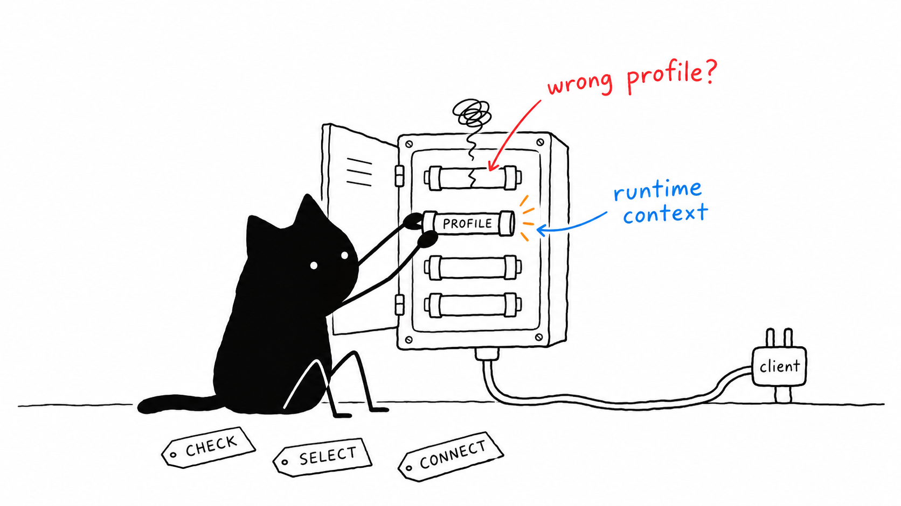

# Installation modes and doctor



The installer supports eight profiles through five modes: `individual`, `runtime`, `docker`, `docker-runtime`, and `nix`. Runtime-based modes support stdio and Streamable HTTP. A mode selects the execution mechanism; a profile selects eligible cells.

Capability setup follows the selected profile. Every canonical profile includes Mitosis, so Needle 3 is provisioned unless `--without-model` is explicitly passed. Profiles containing Cytosol (`dev-workspace`, `research`, `web-devops`, and `all`) also provision the managed Mirage Python bridge and its `cactus-compute[vision]` dependency. Other profiles do not install Mirage. A profile containing Cytosol therefore installs both capabilities automatically.

See [local acceptance evidence](installation-acceptance.md) for the tested mechanisms, real client connections, persistence checks, and platform/integration boundaries.

## Requirements and boundaries

- Use Node 22+ and Git. Native modules need Python, make, a C/C++ compiler, and platform headers. `--mode nix` supplies a pinned development toolchain and packages the runtime with Nix.
- Docker modes require a working Docker daemon and Compose v2. Their images build the selected cells from pinned source; they do not require host npm dependencies or per-cell Dockerfiles.
- The installer and maintenance commands are Node-first and run on Linux, macOS, and native Windows. Use `node setup.mjs` on Unix-like systems, `.\setup.ps1` in PowerShell, or `setup.cmd` in Command Prompt. The Bash files remain compatibility shims; Nix mode still requires a Unix-compatible Nix environment such as WSL.
- The repository build, test, clean, and update runners use Node scripts, including the Windows `npm.cmd` executable where required. Native Windows cold-install acceptance is still a separate verification boundary; optional browser, Android, Blender, provider, and client integrations remain platform-specific.
- The pinned local Needle engine/model is installed by default on Linux x86_64/ARM64, macOS ARM64, and Windows x64/ARM64. `--without-model` explicitly selects core MCP without that integration; it remains available for platforms without a pinned engine. Assets are fetched from an immutable upstream revision, checksum-verified, and accompanied by their license.
- Mirage profiles require Python 3.9+ and network access during installation so the installer can create `browser-mcp/user_data/mirage/.venv` and install `cactus-compute[vision]`. The generated launcher passes the managed Mirage Python path to Cytosol and to the runtime when Cytosol is part of the selected profile. Mirage weights are downloaded and cached by Cactus on first image analysis.
- Chromium/browser services, Android devices/ADB, Blender/its bridge, provider credentials, and GUI client authentication remain separate integration requirements. `READY` does not certify those operations or provide an OS sandbox.

Installation does not start a persistent service, change system packages, replace existing repositories, or rewrite live client settings. Endpoint security and credential rotation are not changed by this installer.

## Managed layout

Default prefix: `${XDG_DATA_HOME:-$HOME/.local/share}/hela/installations/<profile>-<mode>`. Use `--prefix /absolute/path` to choose another directory.

Each prefix contains its own ecosystem metadata, sibling source repositories, verified installation manifest, workspace, private data directories, and generated client fragments. Plastid is cloned at the repository root and built from `ll3m-mcp/brain`.

The installer refuses unmanaged nonempty prefixes, dirty repositories, symlinked repositories, origin/pin/version mismatches, failed installs/builds, and existing explicit output files. A failed install retains a pending marker; doctor and launchers will not treat it as ready. Re-running the same installation performs locked dependency installation, rebuilds, and verifies it again. Existing data is not restored, reset, or deleted.

## Individual servers

```bash
node setup.mjs --mode individual --profile dev-workspace --client opencode --non-interactive
node setup.mjs doctor --mode individual --profile dev-workspace
```

Merge the generated private fragment into the client file after review. Native client entries start an installed launcher, which selects the correct executable, workspace, and persistent data directory. Unrelated client/provider settings are preserved because the installer never overwrites them.

## Single stdio runtime

```bash
node setup.mjs --mode runtime --profile dev-workspace --client codex --non-interactive
node setup.mjs doctor --mode runtime --profile dev-workspace
```

`--runtime` is an alias for `--mode runtime`. `--with-runtime` additionally builds the daemon for an individual installation without switching its client fragment to one connection.

The selected-profile catalog is generated from fresh probes. Runtime verification checks exact cold catalog parity and zero cell startup, including its HTTP transport. The first actual cell call starts only its target.

## Docker: separate cells or runtime

```bash
node setup.mjs --mode docker --profile dev-workspace --client cursor --non-interactive
node setup.mjs doctor --mode docker --profile dev-workspace

node setup.mjs --mode docker-runtime --profile dev-workspace --client opencode --non-interactive
node setup.mjs doctor --mode docker-runtime --profile dev-workspace
```

`--client docker` remains a shortcut for a Docker installation with Compose output. Use `--runtime` with it for the aggregated daemon. Both Docker modes build one profile image; client entries call Docker directly with the immutable image ID, launching separate cell containers or one runtime container. Those stdio clients do not need a host Node runtime after installation. `compose.json` provides the equivalent Compose services.

Filesystem, terminal, and process tools operate inside the container and explicitly mounted workspace. Host SSH keys, device access, external browser engines, and Blender bridges are not silently copied or granted; configure those integrations deliberately.

Stdio needs attached stdin, not published ports. Compose services have `stdin_open: true`, no TTY, and persistent named volumes. Use `docker compose -f /path/to/compose.json run --rm --no-deps -T <service>` for an attached stdio connection; `up -d` alone does not connect an MCP client to stdio.

Doctor starts uniquely named temporary containers with no host data/vault mounts or inherited provider keys, verifies actual MCP replies and image source provenance, and removes those containers. It does not stop existing containers or clean global images/volumes.

## Nix runtime

```bash
node setup.mjs --mode nix --profile dev-workspace --client opencode --non-interactive
node setup.mjs doctor --mode nix --profile dev-workspace
```

Nix supplies the pinned Node/native-build toolchain for cell builds and builds the runtime package. The installation's `nix-runtime` output link is retained as a GC root. This is a packaged runtime plus locked cell builds, not a claim that all ten cells are independent Nix derivations. Keep private files untracked; Git-backed flake references exclude ignored credentials and data from Nix source copies.

## HTTP runtime

```bash
node setup.mjs --mode runtime --profile dev-workspace --transport http --port 8080 --client codex --non-interactive
# Start the installed launcher explicitly; its path is printed by setup:
node /path/to/prefix/hela-mcp-ecosystem/scripts/launch.mjs hela-runtime
node setup.mjs doctor --url http://127.0.0.1:8080/mcp --json
```

The same transport flags work with `--mode nix` and `--mode docker-runtime`. HTTP listeners bind to loopback on the host. Docker publishes only `127.0.0.1:<port>`; `compose.json` includes the HTTP command and port mapping. Explicitly start it with Compose `up -d` if desired.

HTTP fragments are supported for OpenCode, Kilo, Codex, and Cursor. Other client backends fail clearly rather than emit unverified HTTP syntax; use `--client skip` and configure their MCP URL manually. No listener is auto-started during installation. Doctor's private HTTP probe does not substitute for checking the running URL.

## Updates and automatic checks

Managed installations use the immutable `latest-stable` snapshot as their update contract. The controller compares exact cell revisions and declared package versions before changing anything; it does not follow moving cell branches and it never edits live client configuration.

Check an installation without changing it:

```bash
node setup.mjs update check --prefix /path/to/prefix
```

Apply a reviewed update explicitly:

```bash
node setup.mjs update check --prefix /path/to/prefix
node setup.mjs update apply --prefix /path/to/prefix --confirm
node setup.mjs doctor --prefix /path/to/prefix --json
```

An apply stages the release through the same pinned installer used for a clean install, records the previous manifest and release in `<prefix>/.hela-update/rollback-<timestamp>/`, and restores the previous source revisions if verification fails. A successful result includes `restartRequired: true`; restart the runtime and MCP client before using the new build. `--confirm` is mandatory for both the CLI and the runtime agent's `hela.update.apply` tool.

Automatic checks are opt-in and check-only. They do not apply releases, restart services, or alter client files:

```bash
node setup.mjs update auto-check enable --prefix /path/to/prefix --interval-hours 24
node setup.mjs update auto-check status --prefix /path/to/prefix
node setup.mjs update auto-check disable --prefix /path/to/prefix
```

The controller installs a systemd user timer on Linux, a launchd agent on macOS, or a Windows Task Scheduler job on native Windows. The scheduled command only writes the private `.hela-update-check.json` result cache. Network failures are reported as `unknown` and never trigger a mutation. Use `--json` for an agent or monitoring integration; remote metadata must use HTTPS and repository pins remain commit-validated.

## Snapshots, reconfiguration, and failures

```bash
node setup.mjs --mode runtime --profile minimal --snapshot v1.5.1 --client skip --non-interactive
node setup.mjs --reconfigure --prefix /path/to/existing/prefix --client zed --non-interactive
node setup.mjs doctor --prefix /path/to/existing/prefix --json
```

Snapshots must declare exact commits and server versions. Incomplete historical metadata is rejected, not silently ignored. `--dev` follows recorded branches for host modes and records the resolved revisions/versions; Docker requires pinned snapshots. Optional provider keys are read from environment, not command-line secret flags. Generated fragments can contain those supplied credentials and are written with private permissions.

Reconfiguration infers the existing mode/profile/transport from an explicit prefix and only generates another fragment. To change transport or port, rerun installation with the new settings; a stdio fragment must not point at an HTTP-only launcher.

## Switch modes in place

`node setup.mjs mode` converts an existing managed installation to another execution mechanism without creating a second prefix or discarding data:

```bash
node setup.mjs mode --prefix /path/to/existing/prefix --mode runtime --non-interactive
node setup.mjs doctor --prefix /path/to/existing/prefix --json
node setup.mjs mode --prefix /path/to/existing/prefix --mode docker-runtime --client opencode --non-interactive
```

Every mode is a valid target: `individual`, `runtime`, `docker`, `docker-runtime`, and `nix`. The profile, snapshot, workspace, and `data/` directories are preserved; only the artifacts the target mode needs are built. Host-mode switches reuse cells that already sit at the pinned revision with a clean worktree, so repeated conversions take seconds rather than rebuilding every package. Moving into a Docker mode builds the profile image; moving out deletes `compose.json`. Transport and port carry over unless `--transport` or `--port` is passed, and HTTP targets require a runtime mode. Switching to `--mode nix` must run inside Nix, exactly like a fresh Nix install.

The command verifies the converted installation with the same doctor checks used after installation and generates a new client fragment when `--client` is supplied; it never edits live client settings. If verification fails, the previous manifest is restored, a pending marker is written, and the command exits nonzero so doctor reports the degraded state. A pending or unmanaged prefix is refused, and re-selecting the current mode is an error rather than a silent no-op.

Doctor exits nonzero for missing or incomplete installations, modified builds, wrong revisions/versions, missing images, failed MCP replies, and runtime catalog/HTTP failures. A remote `--url` check verifies MCP initialize/discovery and the runtime version, not remote filesystem pins or hardware. Existing standalone sibling/nested checkouts remain diagnosable when no managed installation is selected.

Never overwrite live SQLite files or force vault conflicts to resolve installation warnings. Use validated backups and a deliberate migration if you intend to move existing memory into a new managed prefix.
