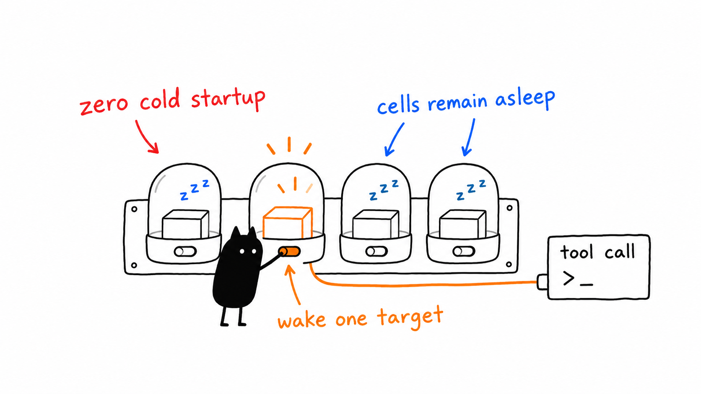

# On-demand runtime and canonical discovery



Runtime **1.2.1** implements §10.3: no cell starts during runtime startup or `tools/list`. The first call starts only its target; concurrent calls share that startup. Cells already started retain the existing crash/timeout supervisor. Standalone MCP servers are unchanged, all eight profiles remain supported, and the runtime/installer default is `minimal` when no profile is selected.

The same endpoint owns profile-aware agent instructions. `prompts/list` exposes `hela-profile-bootstrap`, `prompts/get` renders it from the selected profile, and `resources/read` serves `hela://profile/context`. On a clean workspace, installation also creates a private profile-aware HeLa persona under `agent_persona/` and links the harness entrypoints to it. HeLa is the distributable synthesis of Azzar's private Frea and Mema personal AI assistant personas: Frea contributes autonomous technical execution, while Mema contributes security and continuity discipline. Their private files, memories, credentials, and identifiers are not distributed. Existing `agent_persona/`, `AGENTS.md`, `CLAUDE.md`, or `GEMINI.md` files are preserved; the runtime context remains authoritative for active organelles. No individual cell deployment is required.

## One inventory, generated schemas and counts

`config/inventory.json` remains the source of cell paths, revisions, versions, environment declarations, and conditional tool features. `config/profiles.json` selects membership. Config generation, doctor, version verification, integration, and profile tests use the same inventory loader/path resolution.

The generated `config/tool-catalog.json` contains actual standalone MCP schemas, revision/version metadata, verified build digests, and feature variants. It is a derived artifact, not another server registry. Mitosis currently has four LLM/agent feature combinations; other cells have one schema variant. The generator enables registration flags only for discovery and never invokes model-backed tools.

Build outputs can differ between machines even at one source revision. Multiple digests are retained together only if fresh probes return identical schemas for every declared variant. New or changed conditional tool registration must declare its switches under the cell's `toolFeatures`; other relevant settings belong in its `env` list. Configuration changes require a new runtime instance.

Run from the ecosystem checkout after building the selected cells and runtime:

```bash
npm run catalog:generate -- --profile dev-workspace
npm run catalog:check -- --profile dev-workspace
node setup.mjs doctor --profile dev-workspace --runtime
npm run test:profiles -- --profile dev-workspace
```

The installer refreshes selected-profile catalog entries when installing the runtime. Partial installations do not need unrelated hardware cells. An installation with all cells can omit the profile argument to generate/check all entries.

The same generator writes [profile-count documentation](generated-profile-counts.md) and `docs/site/data/tool-counts.json`. Counts include `hela.pipe` and the optional agent alias; they are feature-dependent ranges, not fixed totals copied into each client configuration.

## Cache isolation and stale metadata

The format-2 private cache separates ecosystem roots, profiles, and namespace modes. Per-cell fingerprints cover declared and actual revisions, build contents, effective feature flags, and declared environment settings. Cache files contain fingerprints and schemas only, not environment values. Atomic publication prevents partial reads.

Legacy, corrupt, and mismatched cache entries are ignored. A valid generated catalog supplies cold schemas without child processes. Missing/stale catalog entries are not advertised. Unknown calls do not scan other cells. Explicit `hela.pipe` routing can start an uncatalogued named cell and learn its schemas; regenerating the catalog restores full cold discovery.

Doctor validates selected paths/builds, real isolated MCP handshakes, package/inventory/snapshot versions and revisions, and—when `--runtime` is requested—exact catalog/tool agreement with zero discovery spawns. Hardware checks are limited to the selected profile and remain separate from MCP readiness. API-key checks report presence, never values or assumed provider readiness.

## Verification scope

- **32/32** runtime regressions pass on x86_64 Linux and native ARM, covering timeout recovery, lazy startup, 24 concurrent first calls, cache invalidation, profile/root/namespace switching, legacy/corrupt caches, explicit bootstrap, and shutdown. **41 fixture PIDs** per run were verified reaped.
- All eight profiles pass **16/16** namespace-off/on discovery/schema/routing checks. Discovery starts zero cells; only the safe Genome/Nucleus probes start those cells. Cold discovery, cold first-call, and warm-call durations are recorded in JSON output without asserting machine-independent latency limits.
- The **80** client-configuration combinations, four probe regressions, and four canonical inventory regressions pass. Default standalone integration now excludes the multiplexing runtime from collision comparisons.
- Eight additional runtime discovery checks cover all four Mitosis feature combinations in both namespace modes, without invoking model tools or starting cells. Doctor reports READY with cold catalog parity for all eight profiles.
- Reproducible Nix packages use Node 22.23.4 and pinned/fixed-output inputs on both Linux architectures. Runtime versions derive from package metadata.

These checks do not authenticate GUI ACP sessions, reconcile live vault conflicts, exercise Android/Blender hardware, invoke model providers, or complete deferred endpoint security. Lappy retains its ten-server roster; servy retains its eight-cell `dev-workspace` selection.

## Historical Servy rollout — runtime 1.2.0

This section records the deployed Servy HTTP service, which remains on runtime `1.2.0`. The current source checkout and direct stdio runtime are `1.2.1`; this evidence is retained because the systemd deployment has not been promoted to that source version. Runtime source `9c92dbf5612db43fe80f1680ba4af97c4b5ea9b0` and ecosystem source release `1c47ca1c202c6a2acea79d7c6fdac5a19ef3c0bf` are deployed. Final-source Nix outputs are:

- x86_64-linux: `/nix/store/r15rmywrswf01nj2xrvx753p1fh4f6rh-hela-runtime-1.2.0`.
- aarch64-linux: `/nix/store/bhm781bld50yi9brmy2mn74p1ybzdzcy-hela-runtime-1.2.0`.

The ARM package is rooted under `/home/ubuntu/.local/state/hela/deployments/todo103-psnzx8x4/runtime`. Promotion fast-forwarded clean source checkouts, retained the old build/drop-in, and took fresh integrity-checked online backups of three databases plus a vault archive. Existing profile, environment, host, port, and security settings were preserved; only the selected runtime executable changed.

Local and public HTTP initialize/discovery report runtime **1.2.0**, **236 unique tools**, all three Genome mission tools, and no hardware-only tools. Both discovery checks left the service with **zero child cells**. A safe `terminal_session_list` call started only Nucleus; Genome did not start. Observed Nucleus calls were approximately **471 ms cold** and **13 ms warm** in this one run, including HTTP/MCP overhead—not a portable benchmark.

Deployed doctor reports READY, catalog parity is exact, revision checks pass, and the GC root is verified. All previous HTTP-service PIDs exited. All **633** pre-rollout conflict archive files retained their hashes. No database file was restored/replaced, and unrelated client-owned runtimes and the legacy PM2 gateway were not stopped.

The rollout directory contains `manifest.json`, `http-verification.json`, `doctor.log`, `versions.log`, `catalog.log`, `backup/`, `rollback-dist/`, and the package GC root. Native committed-source staging/test evidence remains under `/home/ubuntu/.local/state/hela/staging/todo103-release-ah25pauz/`; local test/measurement logs are under `/var/tmp/scratch/opencode/todo103/`. Authenticated ACP, deliberate external-client reloads, gateway consumer review, vault reconciliation, and deferred security remain separate.
