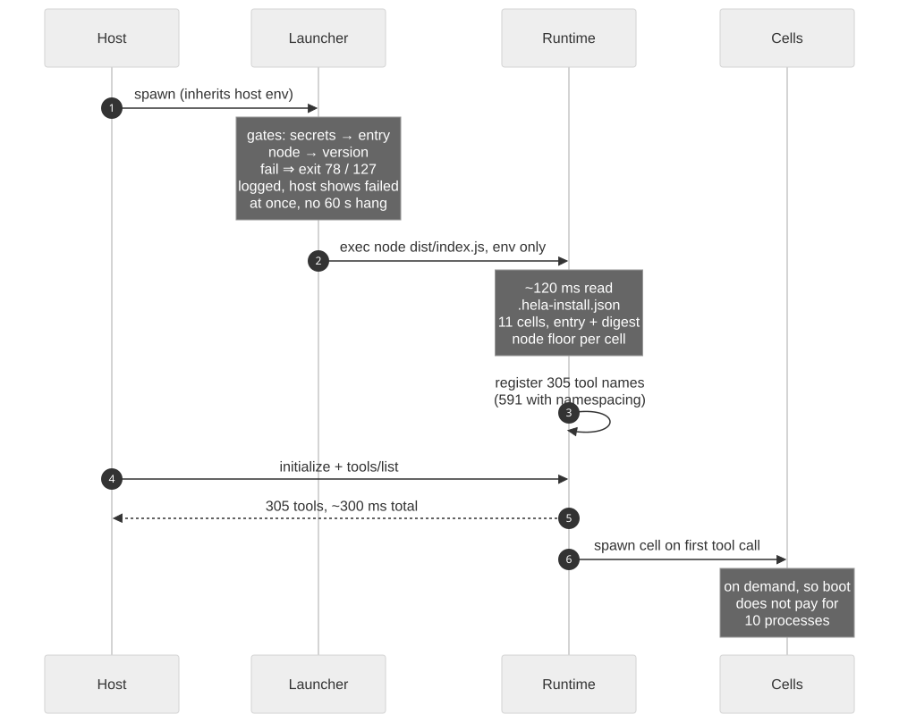
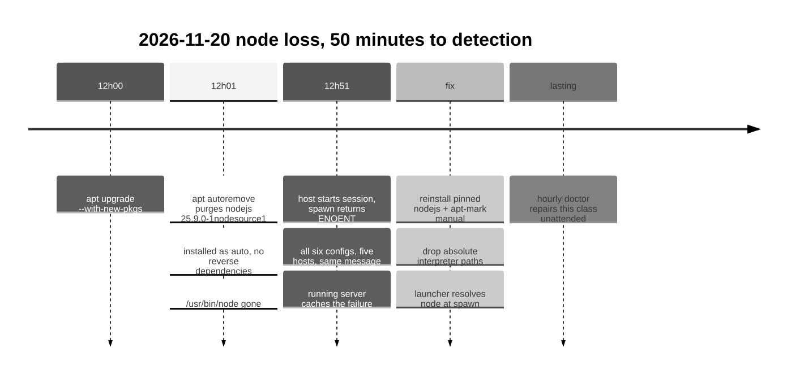

# HeLa MCP Reliability Contract

How the MCP stack is wired, what breaks it, and how to repair it. Written after the
2026-11-20 outage where `apt-get autoremove` purged `nodejs` and every MCP host
failed with `NotFound: ChildProcess.spawn (/usr/bin/node …)`.

Audited 2026-11-21 by a second agent against the live system; every number here was
re-measured or dropped. Where a figure is approximate, it says so.

## How the diagrams work

Each diagram exists twice, on purpose:

- **Rendered SVG** in `docs/diagrams/*.svg`, embedded below. This is what `markm`
  displays — its renderer is `markdown-it` + `highlight.js` + `katex` with **no Mermaid
  plugin**, so a raw Mermaid block would appear as code. It also runs with `html: false`
  and escapes raw HTML, which is why this document contains no `<details>` or inline
  `` tags: they would print as literal text.
- **Mermaid source** in `docs/diagrams/*.mmd`, linked under each diagram. Edit there and
  re-render; never hand-edit an SVG.

Relative image paths are safe: markm rewrites a relative image reference into
`data-local-src`, resolves it against the open document's directory (normalising `..`),
then loads it through Neutralino's `filesystem.readBinaryFile`.

GitHub, Obsidian and VS Code render the embedded SVG natively.

Regenerate after editing any `.mmd`:

```bash
cd docs/diagrams
for f in *.mmd; do
  PUPPETEER_EXECUTABLE_PATH=/usr/bin/google-chrome \
    npx -y @mermaid-js/mermaid-cli@11 -i "$f" -o "${f%.mmd}.svg" -b white -t neutral
done
```

White background with the `neutral` theme on purpose: the SVGs stay readable in light
and dark viewers alike.

| Diagram | Question it answers |
|---|---|
| 1. Layer map | What talks to what, and who owns which failure? |
| 2. Boot timeline | What happens between "host starts" and "305 tools"? |
| 3. Triage tree | Host says *failed* — where do I look first? |
| 4. Cell supervision | Why did one tool stop working mid-session? |
| 5. Trust boundaries | Who can write credentials, and what can the sandbox touch? |
| 6. Incident anatomy | How did the 11-20 outage actually unfold? |
| 7. Check loop | What runs hourly, and what may it change on its own? |
| 8. Before/after | Why is it one launcher instead of six inline configs? |

**Naming:** there are **5 client applications** and **6 config files** — Gemini keeps two
(`~/.gemini/settings.json` and `~/.gemini/config/mcp_config.json`). Diagrams that say
"configs" mean six; diagrams that name hosts show five.

---

## 1. Layer map



*Source: [01-layer-map.mmd](diagrams/01-layer-map.mmd) — edit, then re-render (see top).*

- The **host** only knows one command. If it reports failure, the problem is at or below
  the launcher — never "that one client's settings" unless `hela-doctor` says `hosts` is
  drifting.
- The **cells** are children of the runtime. If the runtime boots and lists tools, the
  host is healthy even if one cell later dies (diagram 4).
- The launcher's own overhead is ~6 ms. A bare `node` start is ~25 ms, so the launcher is
  not a meaningful cost — it is one shell process plus four tests the runtime would
  otherwise fail on later with a worse message.

### Why the shape changed



*Source: [08-before-after.mmd](diagrams/08-before-after.mmd) — edit, then re-render (see top).*

The left side is what the machine looked like before this work: five clients each holding
27–31 env vars inline, two of them already disagreeing on `NEEDLE_TOOL_INDEX_PATH` and
`HELA_ALLOWED_ROOTS`, and every one of them pinning `/usr/bin/node`. The right side is
today: identical command everywhere, one file to rotate, one place to repair.

## 2. Boot timeline



*Source: [02-boot-timeline.mmd](diagrams/02-boot-timeline.mmd) — edit, then re-render (see top).*

Measured three times against the launcher: `initialize` is answered at ~257–269 ms
(mean ~262 ms), and `tools/list` adds ~3 ms. So **tool registration is the cheapest step**,
not the expensive one — nearly all of the time is Node starting and the runtime reading
its cell catalog. Budget ~300 ms total.

| Exit | Meaning |
|---|---|
| `78` | unreadable secrets, missing entry, or node below the required floor |
| `127` | no node on PATH, **or** `node -v` unparseable (the message names the binary and the raw output) |
| silent | runtime booted but exposed 0 tools → `HELA_PROFILE` or manifest |

Host-side startup timeouts are separate: Codex uses `startup_timeout_sec = 60`, and the
doctor's own probe allows 90 s by default (120 s in the timer). Nothing in the chain
assumes 60 s.

Why the launcher logs to a file as well as stderr: hosts swallow child stderr. After a
failure the UI keeps only a one-line status; the log keeps the reason. The timestamp is
best-effort — if `date` is unavailable the line still records the reason, with
`unknown-time` in place of the clock.

## 3. Triage tree



*Source: [03-triage.mmd](diagrams/03-triage.mmd) — edit, then re-render (see top).*

Start at the symptom the host actually showed. Note the asymmetry: interpreter and wiring
failures are fatal for every host, cell deaths are contained to one tool family, and
sandbox denials are normal behavior that merely reports badly.

## 4. Cell supervision


*Source: [04-supervision.mmd](diagrams/04-supervision.mmd) — edit, then re-render (see top).*

Restart delays are **1 s, 2 s, 4 s**. The code caps the delay at 8 s, but with the default
three attempts that cap is unreachable — the third failure marks the cell dead before any
delay is computed.

More important, and easy to misread: **the attempt counter is never reset**. A cell that
crashes, recovers, crashes, recovers, then crashes again is dead on that third crash, even
across hours. It is three strikes per runtime lifetime, not per outage. Only a host
restart re-arms.

## 5. Trust boundaries



*Source: [05-trust-boundaries.mmd](diagrams/05-trust-boundaries.mmd) — edit, then re-render (see top).*

Two separate boundaries, often confused: *who may write credentials* and *what the sandbox
may touch*.

`mcp.env` is **sourced as shell**, not parsed. `set -a; . "$SECRETS"` means any command
substitution or function definition in that file executes as you at every MCP session
start, across all six configs. The boundary that matters is therefore **write** access to
`~/.config/hela/` — 0700 dir, 0600 file. The launcher warns if the file is group/world
readable; `hela-doctor` fails it and `--repair` fixes it.

The `~/gdrive` exclusion is not incidental — that tree contains a Drive shortcut cycle
(a shortcut pointing back into its own folder), which makes any local traversal descend
until `PATH_MAX`. Keeping it outside the roots means the filesystem cell cannot be walked
into that trap.

## 6. Incident anatomy



*Source: [06-incident.mmd](diagrams/06-incident.mmd) — edit, then re-render (see top).*

The 50-minute gap between cause and symptom is the reason the launcher now logs and the
timer checks hourly. The other lesson: **restarting the app alone does not clear this** —
the host caches the failed connect, so the binary has to exist first.

## 7. Check loop



*Source: [07-doctor-loop.mmd](diagrams/07-doctor-loop.mmd) — edit, then re-render (see top).*

The doctor has ~22 distinct check names; which ones emit depends on state. A healthy run
today prints 17 lines (15 ok, 2 warn) in ~0.4 s including the live handshake. The two
steady-state warnings are housekeeping: credential-bearing backups, and shadowed tools.

| Layer | Check line | Detects | `--repair` |
|---|---|---|---|
| Interpreter | `node`, `node-mark`, `node-floor`, `node-path`, `node-shadow`, `npm` | missing/old node, **auto-marked nodejs**, stale launcher gate, PATH shadowing | node only |
| Runtime | `manifest`, `runtime-entry`, `runtime-deps` | missing/unreadable manifest, missing `dist/index.js`, missing MCP SDK | no |
| Cells | `cells` | unbuilt entry, absent `node_modules` | no |
| Assets | `needle-engine`, `needle-model`, `needle-profile`, `scrcpy-server` | truncated model, non-executable engine, missing adb payload | no |
| Secrets | `env-file`, `env-dir`, `env-keys`, `env-credentials` | perms, missing keys, **blank/truncated credentials** | perms |
| Wiring | `hosts`, `host-mode:<name>`, `host-missing`, `host-binaries` | drift off the launcher, disabled client, dead third-party commands | no |
| Exposure | `host-secrets`, `backups`, `backups-large` | plaintext keys in configs, credential backups, unscannable large backups | chmod 600 |
| End-to-end | `live` | handshake, tool count, shadowed tools | no |

`--repair` performs four mutations, all idempotent: `apt-get install nodejs` +
`apt-mark manual`, `chmod 600` on `mcp.env`, `chmod 700` on `~/.config/hela`, and
`chmod 600` on credential-bearing `*.bak*` (including large ones it cannot scan). It never
edits a host config.

## The three failure classes seen so far

| Class | Symptom | Detection | Repair |
|---|---|---|---|
| Interpreter loss/downgrade | `ChildProcess.spawn (/usr/bin/node)` NotFound; or cells failing on `engines.node` | `node`, `node-mark` | `--repair` reinstalls the pinned package and re-marks it manual |
| Config drift | one client works, another doesn't; keys missing or stale | `hosts`, `env-keys` | point `command` at the launcher; restore keys from `*.bak-secrets-centralized` |
| Credential sprawl | plaintext keys in host configs or backups | `host-secrets`, `backups` | strip env blocks; chmod 600 or delete backups |

## Commands

```bash
hela-doctor                      # full check + live handshake (~0.4s)
hela-doctor --json               # machine-readable
hela-doctor --repair             # fix node, credential modes, backup exposure
hela-doctor --no-live            # skip the handshake (offline / no network)
hela-doctor --notify             # desktop alert on failure
```

Exit codes: `0` healthy (warnings allowed), `1` failures, `2` doctor itself broke
(`--notify` fires on 2 as well). Logs: `journalctl --user -u hela-doctor.service`;
launcher failures append to `~/.local/state/hela/logs/mcp-launcher.log` (rotated at
512 KB).

Note that a plain run is not read-only: it writes `~/.local/state/hela/node-min-major`
(the launcher's version gate) and refreshes `node-pin` (the version `--repair` restores).

## Automation

`hela-doctor.service` runs
`%h/.local/bin/hela-doctor --repair --notify --timeout 120` 2 minutes after login and
hourly thereafter. It exits 1 on genuine failures; `SuccessExitStatus=0 1` keeps that an
alert rather than a failed unit.

Two facts worth knowing:

- `Persistent=true` in the timer is inert — it only applies to `OnCalendar=` timers.
- The steady state includes one permanent warning: 31 credential-bearing backups exist.
  `0 warn` is not achievable until they are deleted.

## Operating rules

1. **Never pin an absolute interpreter in host configs.** Use the launcher; it resolves
   `node` at spawn time and fails with an actionable message. Note the exception: the
   installer manifest `.hela-install.json` still carries `"node": "/usr/bin/node"`. No
   runtime code reads it — only the ecosystem's install/launch scripts and this doctor —
   so it is a latent trap, not a live one. Retire it when convenient.
2. **One credentials file, and treat it as code.** `~/.config/hela/mcp.env`, 0600, dir
   0700. It is sourced, so anyone who can write it can run code as you at every session
   start. Never paste keys into client configs.
3. **Keep nodejs marked manual.** `hela-doctor` now fails with `node-mark` if the mark
   drifts back to `auto` — that mark is what let `autoremove` delete the runtime the first
   time — and `--repair` re-asserts it.
4. **`HELA_ALLOWED_ROOTS` is the sandbox boundary.** Currently project, Documents,
   Downloads, persona, skills, memory, HeLa state/install, `/tmp`, `/var/tmp`. Add a root
   when a legitimate tool is denied; never restore `/`.
5. **After changing `mcp.env` or the launcher, restart the host.** A running MCP server
   keeps the env it booted with, and hosts cache a failed connect until restart.
6. **Do not pass `HELA_SECRETS_FILE` or `HELA_RUNTIME_ENTRY` through a host.** The
   launcher ignores them by design; if you find a config setting one, that is drift.

## Known limits

- **The live probe proves less than it looks.** It spawns no cell and calls no tool:
  `tools/list` is answered from the manifest cache because cells are created on first
  tool call. `[OK] live 305 tools` means node runs, the launcher gates pass, the manifest
  parses and the SDK answers. No cell is known to be executable.
- **305 of 591 declared tools are reachable.** With `HELA_NAMESPACE_TOOLS=0`, bare names
  collide across cells and the runtime keeps whichever cell registered last; the agent
  catalog resolves the same collisions first-cell-first. The doctor reports the 286
  shadowed names as a warning. Turning namespacing on exposes all of them but renames
  every tool, so it is a deliberate choice, not a flip.
- Policy denials from `filesystem-mcp` surface as `Invalid tools/call result:
  invalid_union` instead of `path escapes configured workspace roots` — the cell returns
  a malformed error shape. Access is still denied; only the message is wrong.
- `node-shadow` and `npm` warnings are informational; `--repair` cannot fix a PATH that
  resolves a different node, only the installed package.
- Diagram SVGs carry mermaid's `<foreignObject>` labels, which browsers render but
  non-browser rasterizers (librsvg, ImageMagick) drop — boxes appear empty. Use Chrome
  headless to flatten to PNG.
- Audit tooling caveat: `rtk`-wrapped `cat`/`sed`/`wc` has served a stale revision of this
  file (410 lines) while `/usr/bin/*` showed the current one. When verifying a document,
  read it with absolute binaries.

## Rollback

Every config touched during the hardening carries a sibling backup:

- `*` + `.bak-secrets-centralized` — pre-launcher state (inline env, per-client commands)
- `*` + `.bak-provider-key-authjson` — opencode.json before the provider key was dropped
  (key lives in `~/.local/share/opencode/auth.json`, same value)
- `*` + `.bak-node-path-hardening` — state right after the `/usr/bin/node` fix

Older backups exist from earlier work (`~40` files across ~8 suffix families); 31 still
contain credentials, all mode 600. Restoring any backup puts credentials back in that
file; chmod 600 it and re-run `hela-doctor`.
